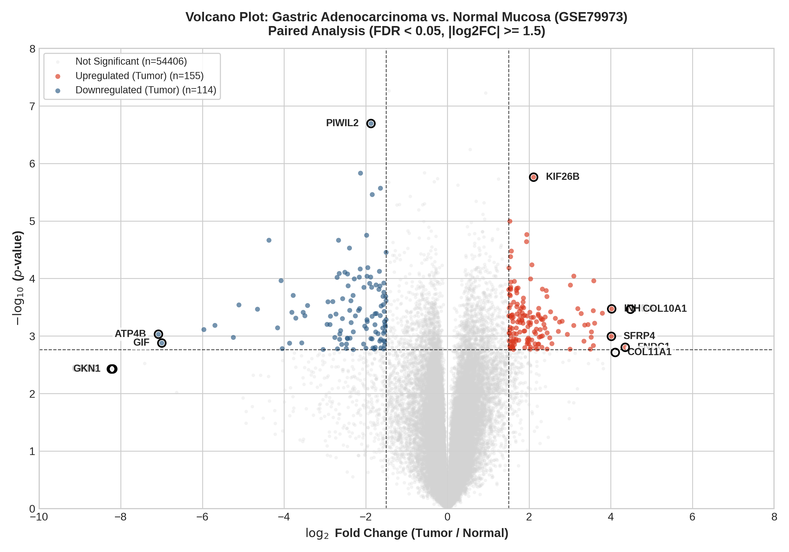
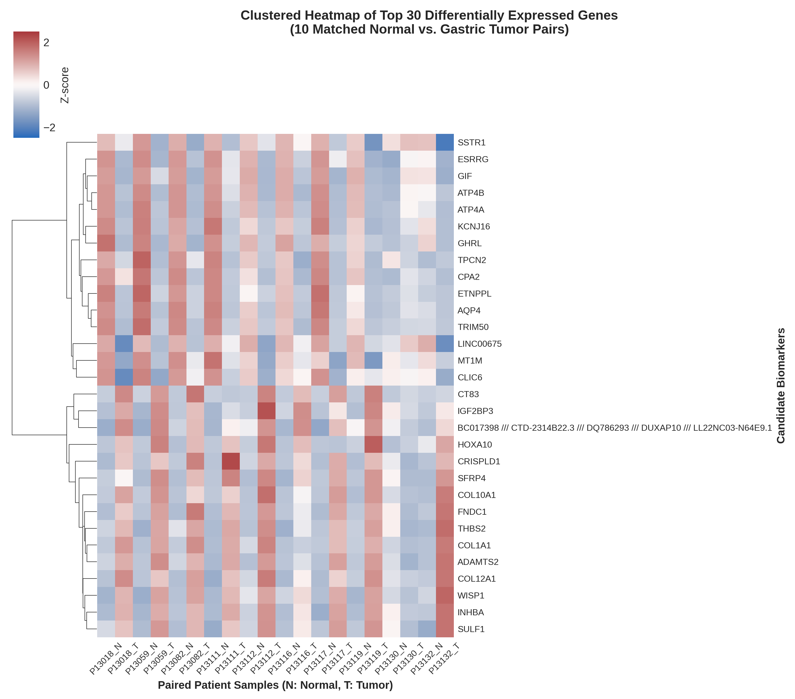

# Transcriptomic Biomarker Discovery in Gastric Adenocarcinoma

[](https://opensource.org/licenses/MIT)
[](https://www.r-project.org/)
[](https://bioconductor.org/)

An automated R pipeline for raw Affymetrix HG-U133 Plus 2.0 microarray preprocessing, Robust Multi-array Average (RMA) normalization, dynamic probe annotation, and paired linear modeling with empirical Bayes moderation.

---

## Scientific Context

This pipeline characterizes transcriptional alterations and candidate diagnostic/prognostic biomarker signatures in gastric adenocarcinoma from NCBI GEO accession **GSE79973**. The cohort contains N = 20 arrays representing **10 matched patient pairs** of primary gastric adenocarcinoma (`C`) versus adjacent non-cancerous mucosa (`N`).

Findings from this analysis were selected for an **Oral Presentation** at the *Second International Congress of Cancer Genomics (CGC2024)* (Certificate No: 40321102).

---

## Methodological Workflow

1. **Decompression & Reading (`normalize_affy_geo.R`):** Extracts raw `.CEL` files from GEO `.tar` archives using Bioconductor `affy`.
2. **RMA Normalization (`normalize_affy_geo.R`):** Executes optical background correction, quantile probe-intensity normalization, and median-polish $\log_2$ summarization across 54,675 probe sets.
3. **Dynamic Annotation (`normalize_affy_geo.R`):** Connects to NCBI GEO platform records via `GEOquery` to map probe identifiers to official HUGO Gene Symbols.
4. **Paired Empirical Bayes Modeling (`diff_expr_limma.R`):** Fits a paired linear model (`~ Patient + Tissue`) using `limma` to control for inter-individual patient variability, followed by Benjamini–Hochberg False Discovery Rate (FDR) adjustments.

---

## Candidate Biomarkers

Applying statistical thresholds (|Log2 FC|≥ 1.5 and adjusted p-value < 0.05) revealed significant tumor-specific dysregulation:

| Probe ID | Gene Symbol | Regulation | log_2 Fold Change | Adjusted p-value | Clinical / Functional Role |
| :--- | :--- | :---: | :---: | :---: | :--- |
| **`227140_at`** | **INHBA** | Upregulated | **+4.87** | 8.07 \times 10^{-3} | Activin A subunit; TGF-beta signaling pathway, invasiveness |
| **`217428_s_at`**| **COL10A1** | Upregulated | **+4.48** | 7.67 \times 10^{-3} | Collagen type X; desmoplasia, extracellular matrix remodeling |
| **`226930_at`** | **FNDC1** | Upregulated | **+4.35** | 2.14 \times 10^{-2} | Fibronectin type III domain; drives EMT and metastasis |
| **`37892_at`**  | **COL11A1** | Upregulated | **+4.11** | 2.44 \times 10^{-2} | Hallmark marker of aggressive cancer-associated fibroblasts (CAFs) |
| **`238222_at`** | **GKN2** | Downregulated | **-8.23** | 3.68 \times 10^{-2} | Gastrokine 2; mucosal integrity, lost early in carcinogenesis |
| **`220191_at`** | **GKN1** | Downregulated | **-8.19** | 3.68 \times 10^{-2} | Gastrokine 1; gastric mucosal differentiation marker |
| **`207546_at`** | **ATP4B** | Downregulated | **-7.08** | 1.53 \times 10^{-2} | \text{H}^+/\text{K}^+ ATPase subunit; indicates loss of parietal cells |
| **`207033_at`** | **GIF** | Downregulated | **-6.99** | 1.92 \times 10^{-2} | Gastric intrinsic factor; depletion of specialized mucosal cells |

---

## Visualizations

### Paired Volcano Plot
<p align="center">
  
</p>

### Clustered Expression Heatmap
<p align="center">
  
</p>

---

## Usage

```bash
# Clone and enter directory
git clone [https://github.com/AmirShamex/gastric-cancer-biomarkers.git](https://github.com/AmirShamex/gastric-cancer-biomarkers.git)
cd gastric-cancer-biomarkers

# Build conda environment
conda env create -f environment.yml
conda activate gastric-biomarkers-env

# 1. Preprocess and normalize
Rscript normalize_affy_geo.R GSE79973

# 2. Run paired differential expression and generate plots
Rscript diff_expr_limma.R
```


## Conference Citations

If utilizing or adapting these analytical pipelines, please cite the corresponding conference presentations:

**Bahrami, B.**, **Shamekhi, S. A.**, & **Tohidfar, M.** (2024, October 23–25). *Unveiling Potential Biomarkers for Gastric Cancer Through Bioinformatics Approaches* [Oral Presentation]. Second International Congress of Cancer Genomics (CGC2024), Tehran, Iran. Certificate No: 40321102.


---

## License & Contact

* **License:** Distributed under the [MIT License](LICENSE).
* **Author:** Seyed Amirhossein Shamekhi
* **Affiliation:** Department of Microbiology and Microbial Biotechnology, Shahid Beheshti University, Tehran, Iran
* **GitHub:** [@AmirShamex](https://github.com/AmirShamex)
* **LinkedIn:** [Amirhossein Shamekhi](https://linkedin.com/in/amirshamekhi)
* **Email:** [amirhshamekhi@gmail.com](mailto:amirhshamekhi@gmail.com)
